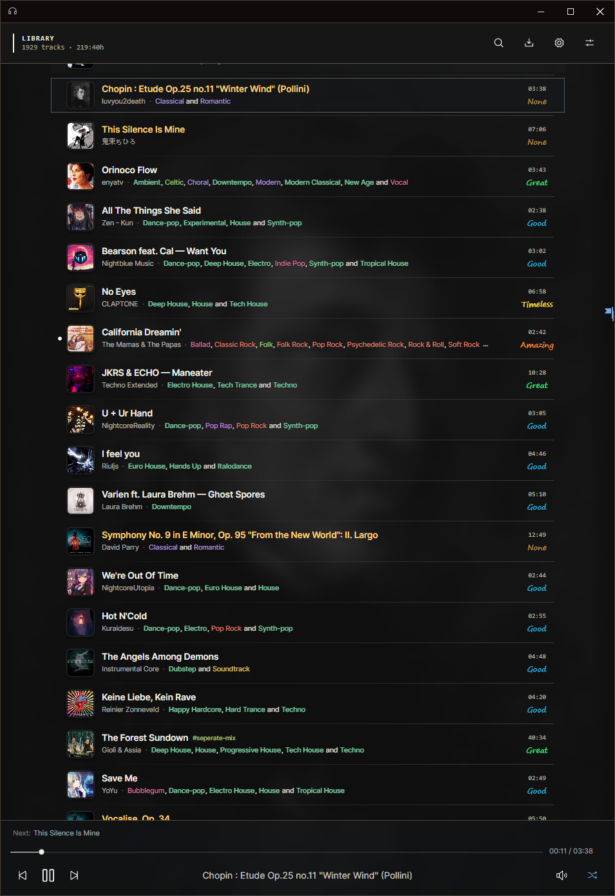
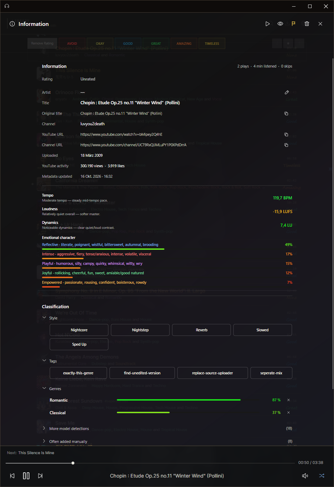
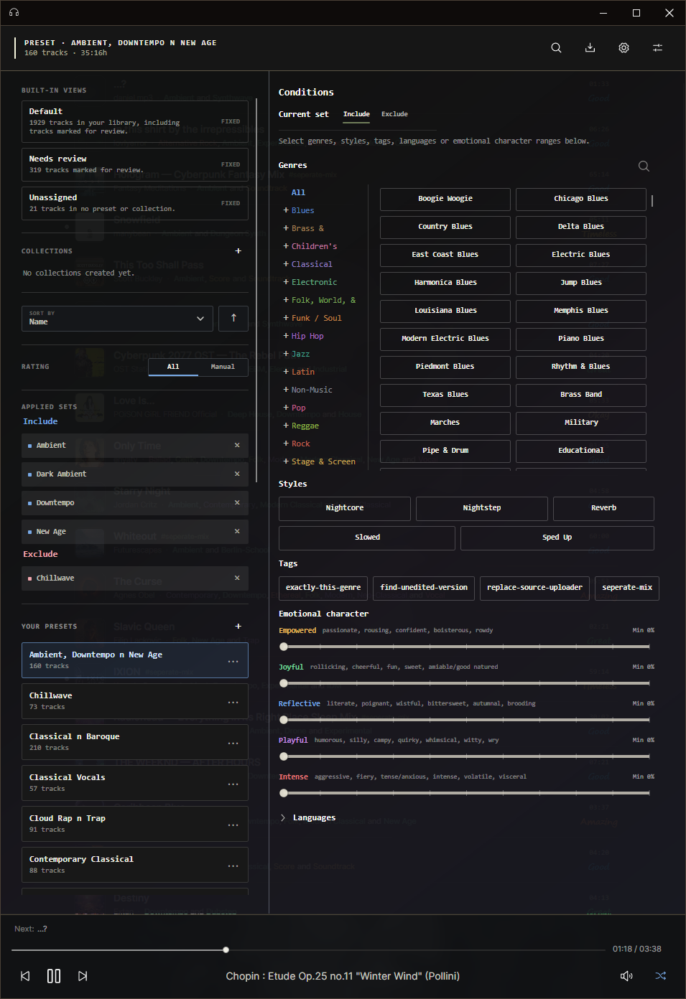

# Resona

Resona is a local music library for Windows and Linux. It downloads audio from YouTube links, stores the library in SQLite, and plays the downloaded files locally.

The desktop app manages imports, playback, metadata, ratings, tags, genres, styles, languages, collections, filters, and playlists. Imports run through a persistent queue, so a video, playlist, mix, or radio URL can be expanded and processed in the background.

Audio analysis is optional. A separate analyzer can provide BPM, loudness, dynamics, genre suggestions, and emotional-character values. The analyzer is located in `src/AnalysisServer` and can run as a Docker service.

The repository also contains an Android app for playing a portable copy of the local library. The desktop application remains responsible for changing library metadata.

This is a personal project. If it matches what you need, you can use it.

## Components

- `src/Resona`: desktop library, player, editor, filters, and import queue
- `src/AnalysisServer`: optional self-hosted audio analyzer
- `src/Resona.Android`: Android player for a copied local library

## Requirements

The desktop application requires:

- Windows or Linux x64
- `yt-dlp`
- FFmpeg and FFprobe
- Node.js for YouTube imports
- `libvlc` for playback on Linux

The analyzer address and other runtime options are configured under **Settings → General**.

## Screenshots

### Library

The main view contains the local tracks, playback controls, ratings, and library actions.

### Track editor

Metadata, ratings, classifications, languages, and analysis results can be edited per track.

### Filters

Tracks can be filtered by ratings, genres, styles, tags, languages, visibility, and analysis values.

### Import

YouTube video, playlist, mix, and radio URLs are expanded into the import queue before downloading.

